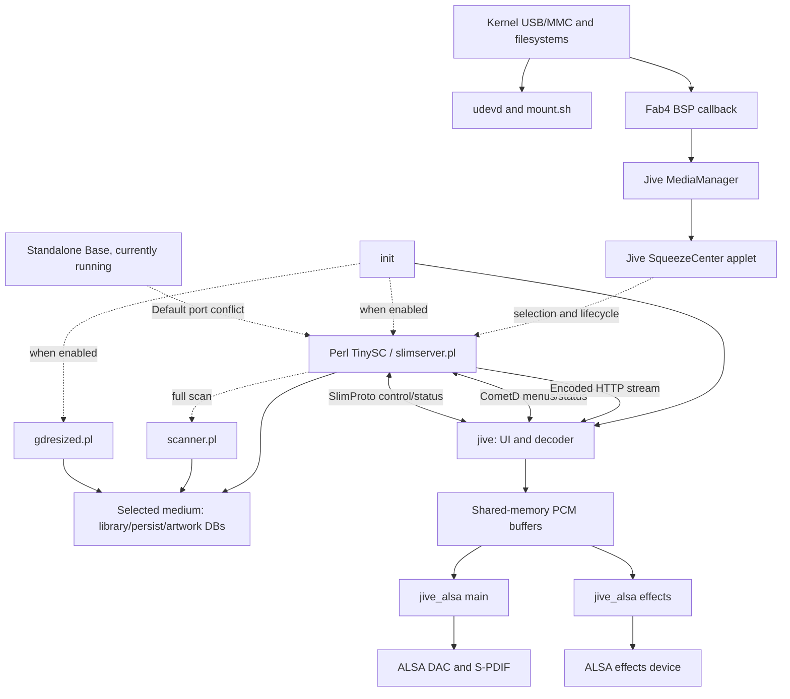
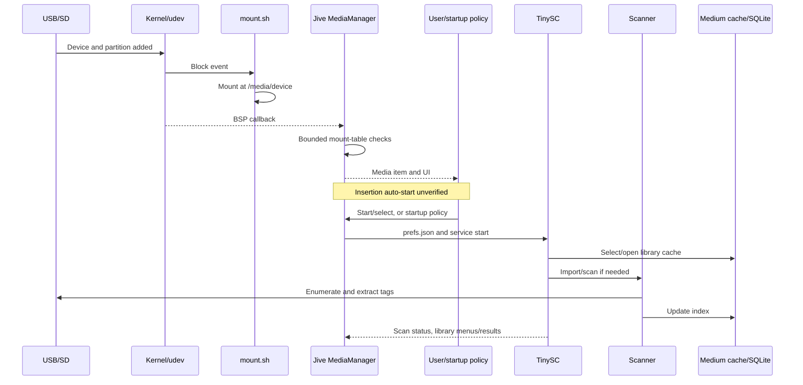
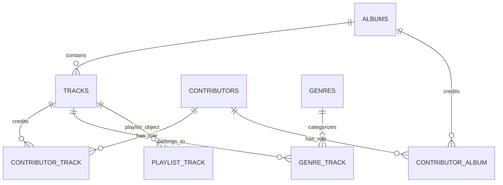
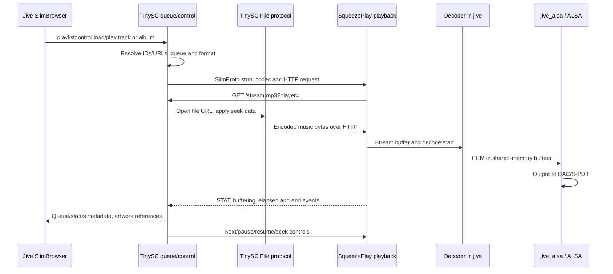

# Squeezebox Touch (Fab4): local music architecture

Research date: **1 November 2026**. Device: the supplied Touch at `192.168.1.244`. Standalone Base reference: release `0.7.0`, commit `0a4b50e`. This report is research, not an implementation or authorization to change device state.

## 1. Findings and confidence

- **Confirmed, source:** TinySC is a reduced packaging/configuration of LMS, not a separate audio player. The installed build identifies `Logitech/slimserver`, tag **7.7.3**. Nine key installed files matched that tag byte-for-byte.
- **Confirmed, source:** TinySC indexes music, manages the queue, opens files and streams encoded audio over HTTP. SqueezePlay receives SlimProto control, fetches and decodes the stream; `jive_alsa` helpers handle PCM output. Normal MP3/FLAC decoding is not performed by TinySC.
- **Confirmed, source:** one active music device is an explicit Touch policy: one selected directory and a library cache on that device. SQLite itself is not restricted to one physical device.
- **Confirmed, source:** library navigation is largely server-defined. Existing Jive browsing and Now Playing can be reused by a sufficiently compatible backend; a file streamer alone is insufficient.
- **Confirmed, runtime:** no USB/SD disk or music volume is currently mounted. TinySC, scanner and resizer are not running. Standalone Base occupies loopback TCP 9000 and TCP/UDP 3483. A stale `/media/sda1` directory is not a mounted drive.
- **Unverified:** TinySC scan/browse/playback resource use, actual insertion behavior, a live music-library schema and multi-player performance. Measuring these now would require changing device state.

**Decision position:** retain TinySC as the first compatibility baseline to test, rather than replacing it by assumption. Final selection between A/B/C is deferred until controlled, explicitly authorized resource/coexistence tests are available.

### Evidence labels and artifacts

**Confirmed** means verified from installed files, inspected source or runtime observations. A source-confirmed action was not necessarily executed. **Documented** means supported by external documentation but not reproduced here. **Hypothesis/proposal** marks inferences or possible future designs.

The [evidence index](research/FAB4_LOCAL_MUSIC_EVIDENCE.md) identifies exact paths, line anchors and SHA-256 hashes for 40 files, referenced below as D01–D40. The [source ledger](research/FAB4_LOCAL_MUSIC_SOURCES.json) and [profile data](research/FAB4_LOCAL_MUSIC_PROFILE.json) accompany it. Original captures remain in ignored `.local/fab4-music-research/` because they contain device-specific settings.

## 2. Method and limits

Performed: read-only SSH inspection; firmware source/settings copied to the workstation; comparisons with original 7.7.3 source; read-only SQLite inspection of a workstation cache copy; three passive `/proc` samples.

Not performed: software changes/installations, service start/stop/restart, firmware changes, mounts/unmounts, media insertion/removal, rescans, database repair/deletion, playback commands or player/server switching. TinySC was not launched even with help/version arguments. Only workstation research artifacts were created; application code was unchanged.

Reading firmware populates page cache. SSH and short inspection commands introduce some load. These limitations are included in the resource interpretation; no profiler daemon or continuous packet capture was added.

## 3. Hardware and firmware inventory

**Confirmed from the device:**

| Item | Observation |
|---|---|
| Board | `Logitech Fab4 Board`, revision `0005` |
| Processor | ARMv6 / `6TEJ`, CPU part `0xb36`, ARM1136 family, VFP present |
| Platform | Fab4/i.MX35, consistent with the board identification and local platform sources |
| Kernel | `2.6.26.8-rt16-332-g5849bfa`, PREEMPT RT |
| Firmware/Jive | `7.7.3 r16676`, build dated 14 February 2014 |
| Visible RAM | `125848 kB`, approximately 122.9 MiB; nominal 128 MiB hardware class |
| Swap | None |
| Firmware libc | Mapped `/lib/libc-2.11.1.so` |
| Perl | `/usr/bin/perl -> perl5.10.0`; `5.10.0`, `arm-linux-gnueabi` |
| SQLite CLI | `/usr/bin/sqlite3`, version `3.7.5` |
| Jive runtime | `/usr/bin/jive`, Lua 5.1 modules, native `fab4_bsp.so` and `squeezeos_bsp.so` |
| Display | Prior ioctl work established 480×272 visible; current sysfs reports 480×544 virtual, 32 bpp |
| Current Base installation | Device applet source says `0.6.7`, `build-target=fab4`; this tested development installation is not the subsequently published 0.7.0 archive |

Serial number and UUID are intentionally excluded from the report.

### Filesystem and persistent storage

**Confirmed, runtime:**

```text
/dev/root    /             cramfs  ro
ubi0:ubifs   /mnt/storage  ubifs   rw,noatime
none         /             unionfs rw,dirs=/mnt/storage=rw:/=ro
ramfs        /tmp          ramfs   rw
ramfs        /var          ramfs   rw
```

The firmware root is read-only, with internal UBIFS overlaid through the merged `/usr` and `/etc` namespace. `/tmp` and `/var` are RAM-backed. Base configuration lives at `/mnt/storage/standalonebase`. `/mnt/sbdata` is not mounted and is not a stock Touch music-server prerequisite.

The UBI volume named `ubifs` reports 21030912 data bytes. `df -k /mnt/storage` reports a merged-root view of 17536 KiB total and 7176 KiB available. That discrepancy prevents treating `df` as precise NAND partition sizing. No partition changes were attempted.

`/proc/partitions` and `/sys/block` show flash/loop devices, with no `sd*` or `mmcblk*` disk. `/media/sda1` is an empty, unmounted directory.

**Confirmed, source/runtime:** MediaManager advertises FAT16/FAT32, NTFS, ext2 and ext3. The kernel reports vfat, ext2/ext3 and FUSE. The mount script selects ntfs-3g for NTFS; this is not a native NTFS-kernel claim. ExFAT/ext4 were absent from the reported filesystem list. These observations do not constitute format-by-format mount tests. [D03, D05]

### Installed components

**Confirmed on the device:**

| Component | Path/role |
|---|---|
| Server | `/usr/squeezecenter/slimserver.pl` |
| Full scanner | `/usr/squeezecenter/scanner.pl` |
| Artwork workers | `/usr/squeezecenter/gdresized.pl`, `gdresize.pl` |
| LMS code | `/usr/squeezecenter/Slim/` |
| SQL migrations | `/usr/squeezecenter/SQL/SQLite/schema_1_up.sql` through `schema_18_up.sql` |
| OS adapter | `Slim/Utils/OS/SqueezeOS.pm` |
| Perl dependencies | Bundled `CPAN/`, `lib/`; system `/usr/lib/perl5`, `/usr/share/perl5`, core `/usr/lib/perl/5.10` |
| Database module | DBI and `DBD::SQLite 1.34_01` |
| Metadata extraction | `Audio::Scan 0.93` |
| Artwork scaling | `Image::Scale 0.08` |
| Filesystem notification | `Linux::Inotify2 1.21` |
| Service script | `/etc/init.d/squeezecenter` |
| Server preferences | `/etc/squeezecenter/prefs/server.prefs`, plugin preferences |
| Jive bridge files | `/etc/squeezecenter/prefs.json`, `scan.json` |
| General cache | `/etc/squeezecenter/cache/` |

The local SqueezeOS recipe `C:/Projects/squeezeos/poky/meta-squeezeos/packages/squeezecenter/squeezecenter_svn.bb` additionally lists JSON::XS, EV/AnyEvent, IO::AIO, XML/HTML/YAML and other dependencies. It corroborates packaging but is not assumed to reproduce every detail of this 2014 image. No conventional package status database was found at the checked opkg/ipkg locations; this is a component inventory, not a complete package-manager export.

### Decoders and outputs

**Confirmed, runtime:** Jive maps `libmad.so.0.2.1`, `libFLAC.so.8.2.0` and `libvorbisidec.so.1.0.2`. These filenames are not semantic library-version claims. The executable also contains AAC/WMA decoder symbols such as `aacDecoder_ConfigRaw`, `aacDecoder_Close`, `wmavdecInit` and `decode_set_wma_guid`.

**Confirmed, source:** public SqueezePlay 7.7 registers ALAC, Vorbis, FLAC, PCM and MAD, plus private WMA/AAC/Spotify decoders when `WITH_SPPRIVATE` is enabled. Installed Lua uses `squeezeplay.decode`; the installed custom conversion rule explicitly selects native ALAC because transcoding is unavailable. Decoder presence is not a successful test of every codec, container, sample rate or DRM variant.

**Confirmed, runtime/source:** ALSA cards are `TXRX` (S/PDIF), `fab4`/AK4420 and `fab4_1`/WM8974. `/etc/asound.conf` combines S/PDIF and AK4420 with `pcm.multi`, defaulting to `plugmulti`. Main output uses `default`/24-bit configuration; effects use `plughw:2,0`/16-bit. This differs from the Radio's speaker-oriented audio setup. [D38–D39]

## 4. TinySC lifecycle and shared LMS architecture

**Confirmed, source:** the service starts:

```text
nice -n 5 /usr/squeezecenter/slimserver.pl
  --charset utf8 --noimage --novideo --noupnp --noweb
  --notranscoding --nosb1slimp3sync --nostatistics
  --noinfolog --nodebuglog --logfile syslog
```

PID files are `/var/run/squeezecenter.pid`, `/var/run/scanner.pid` and `/var/run/gdresized.pid`. The init script has start, stopserver, stopscan, stopresizer, stop, rescan and restart actions. Its `rescan` action restarts the server; this is distinct from incremental scanner APIs. Jive uses those lifecycle mechanisms. They were inspected, never executed. [D01, D07]

`Slim::Music::Import` launches a separate scanner using the configured Perl interpreter, preference directory and priority. Incremental rescans can run through the in-process async scanner path, so a scanner process is not necessarily permanent. [D11–D12]

**Confirmed, comparison:** these nine installed files matched Logitech's 7.7.3 tag byte-for-byte: `slimserver.pl`, `scanner.pl`, `Slim/Schema.pm`, `Slim/Menu/BrowseLibrary.pm`, `Slim/Player/Protocols/File.pm`, `Slim/Utils/AutoRescan.pm`, `Slim/Utils/SQLiteHelper.pm`, `Slim/Utils/OS/SqueezeOS.pm`, `SQL/SQLite/schema_16_up.sql`.

TinySC shares the LMS database, browsing, command, streaming, playlist and scanning implementation. Touch differences concentrate in SqueezeOS paths/policies, media/lifecycle applets, packaging and launch flags. `--noweb` removes the full web UI, not HTTP audio/raw APIs. `--noimage`/`--novideo` concern media-library features, not wholesale removal of album-art processing: the artwork worker remains installed and is started separately. `--notranscoding` explicitly disables server transcoding. [D08, D33–D36, D40]

### Component/process diagram

Dotted TinySC process edges show expected behavior **when started**, not processes observed running today.



**Confirmed, runtime:** Jive has two `jive_alsa` children. All three map `/SYSV0000de01`; the playback helper opens PCM cards 0/1, the effects helper card 2. Public 7.7 `decode_alsa.c` uses SysV key **56833 = 0xde01** and forks/execs those helpers. This corroborates the mechanism; it is not a claim that public C source exactly matches every private decoder in the binary.

## 5. USB/SD discovery and indexing

### Source-confirmed sequence

1. USB mass-storage or MMC/SD hardware produces a block device/partition. Firmware recognizes `sd*` and `mmc*` names; exact numbering is not stable identity. No insertion occurred during this task.
2. `/etc/udev/rules.d/local.rules` runs `/etc/udev/scripts/mount.sh` on block add/remove. The script checks a blacklist, determines filesystem type with `vol_id`, mounts `/media/<device>` and records a RAM-backed automount marker. FAT has explicit options; NTFS selects ntfs-3g. Normal mount handling also restarts Samba. None of these actions was triggered here. [D02–D03]
3. A native BSP callback reaches `SqueezeboxFab4`'s Lua uevent dispatcher. MediaManager registers a listener. The native transport below the callback was not independently traced; kernel-uevent/netlink transport is plausible, not an observed packet capture. [D04–D05]
4. MediaManager handles partition events, polls `/proc/mounts` once per second with a 60-check bound, and adds a media Home item after mounting. It then shows an eject-warning/media window. Read-only media affects menu actions. [D05]
5. The SqueezeCenter applet offers Start/device-switch actions, writes one selected `devName`, `mountpath` and `audiodir` into prefs.json and starts/restarts the server. Multiple mounted devices produce a chooser. On Jive startup, a still-mounted previous selection is retained; otherwise USB candidates are preferred before other media. Table iteration among several same-type devices is not guaranteed physical insertion order. [D06–D07]
6. The server reads prefs.json. `_setupMediaDir` requires an acceptable writable `/media/...` path represented in the mount table. It creates `.Squeezebox/cache`, sets `mediadirs` to one element, selects that library cache, resets `dbsource` and configures `Playlists`. [D08]
7. Import/scanner logic discovers files, extracts metadata, updates SQLite and associates artwork. Scan progress goes to scan.json for the firmware UI. [D07, D11–D15]
8. Discovery/library selection connects Jive and its player to TinySC. The server supplies My Music menus and paged browse results. [D24–D29]

### Insertion auto-start: source and documentation differ

**Documented:** historical TinySC/Touch guides describe automatic startup when media is inserted.

**Confirmed in inspected firmware:** the active MediaManager mount path ends in an eject-warning/media menu, with a Start action provided by SqueezeCenter. `mmRegisterOnMountHandler` exists, but this MediaManager code does not invoke its stored mount-handler table. An older `SqueezeCenterApplet:udevEventHandler` method also exists, but its Meta does not register it as the active udevEventHandler service; MediaManager owns that service.

Therefore insertion-time automatic TinySC startup is **not established for this exact installation**. Startup with an already mounted medium is explicit. This distinction must be resolved with an authorized insertion experiment rather than by assuming an unused method is active.



### Incremental changes and eject

**Confirmed, source:** SqueezeOS defaults to `autorescan=1`. Linux::Inotify2 and an EV read watcher monitor directories. Create/move/close-write/delete events are filtered and newly created directories gain watches. AutoRescan coalesces events with a **15-second** settling delay, collapses redundant paths and performs async rescans. Full scans and watchers are coordinated. Stat-based fallback exists; the stored interval is ten seconds. Current `max_user_watches` is 8192; actual watch count and large-library behavior were not measured. [D09–D11]

MediaManager calls registered eject handlers before unmount. SqueezeCenter stops its server only when the selected SC medium is being ejected. Expected eject and unexpected removal have separate paths. A future extension should cooperate with this lifecycle, not independently automount or continuously scan every directory under `/media`. [D05–D07]

## 6. Database, paths and persistence

### Stores and location

**Confirmed, source plus historical preferences:**

```text
/etc/squeezecenter/prefs.json                  selected-device bridge
/etc/squeezecenter/prefs/server.prefs          server configuration
/etc/squeezecenter/cache/cache.db             general internal cache
/media/<selected>/.Squeezebox/cache/library.db
/media/<selected>/.Squeezebox/cache/persist.db
/media/<selected>/.Squeezebox/cache/artwork.db
/media/<selected>/Playlists/
```

SQLiteHelper selects `library.db` under `librarycachedir` and attaches `persist.db`. ArtworkCache explicitly uses that library cache root and an `artwork` namespace; DbCache turns the namespace into `artwork.db`. The general cache uses the internal `cachedir`. These databases have distinct purposes. [D08, D14, D20–D21]

Old preferences record:

```text
httpport: 9000
librarycachedir: /media/sda1/.Squeezebox/cache
dbsource: dbi:SQLite:dbname=/media/sda1/.Squeezebox/cache/library.db
playlistdir: /media/sda1/Playlists
```

**Confirmed, runtime:** that library.db is currently absent. Stored prefs and scan.json describe earlier state, not a currently mounted/scanning library.

**Confirmed, read-only inspection:** the copied internal cache.db has this table:

```sql
CREATE TABLE cache (k INTEGER PRIMARY KEY, v BLOB, t INTEGER);
```

It is **not** the music library. The cache's WAL/SHM files were copied too, and the workstation copy was opened using SQLite `mode=ro`. No database connection was opened against the original device files.

### Music schema

**Confirmed, shipped source—not a live music DB:** SQLite migrations run through **18**. The actual migration version of a mounted music library was not inspected. Schema 16 rebuilds `tracks`; 17 restores indexes; 18 adds DLNA/hash fields. [D15–D19]

| Table/store | Role and significant fields |
|---|---|
| `tracks` | Audio and playlist objects; ID, file URL, title/sort/search, album, track/disc, content type, duration, timestamp/size, audio offset/size, sample parameters, ReplayGain, `urlmd5`, `coverid`, cached-cover state and later hash/DLNA fields |
| `albums` | Title/sort/search, year/disc/compilation, contributor; `artwork` points to a track cover ID |
| `contributors` | Artist/album-artist and other contributor entities |
| `contributor_track`, `contributor_album` | Role-sensitive many-to-many credits |
| `genres`, `genre_track` | Genre entities and membership |
| `playlist_track` | Ordered membership of playlist objects represented in `tracks`; schema 10 changes the member `track` column to **text**, not an unconditional numeric track FK |
| `scanned_files`, `progress`, `rescans`, `unreadable_tracks` | Discovery comparison, scan progress/history and failures |
| `metainformation`, migration bookkeeping, `pluginversion` | Version/metadata state |
| `persist.db:tracks_persistent` | Ratings/play-count style persistent data; statistics are disabled by normal init flags, so schema existence does not prove all counters are populated |
| `artwork.db:cache` | Artwork blobs and associated source/type/mtime data |



The diagram deliberately does not depict playlist members as a numeric track FK: migration 10 allows text references.

**Confirmed, source:** scanning converts paths with `fileURLFromPath`; playback resolves them with `pathFromFileURL`. Stored URLs include the media mount prefix. Schema 16 makes track URLs `COLLATE NOCASE`. Separate search/sort columns and ordinary SQLite indexes underpin the inspected queries; there is no basis here to assume a modern FTS5 index. [D11, D16–D19, D30]

### Reuse, corruption and recovery

**Confirmed, source:** existing libraries are reused/migrated rather than automatically rebuilt every boot. AutoRescan can scan for changes made while the server was off. SQLiteHelper configures WAL, `synchronous=OFF`, foreign keys and checkpoints. Its `checkDataSource` is a no-op with a WAL comment, not an integrity-repair routine. WAL does not remove all unsafe-eject/power-loss risk. [D09, D14–D15]

DbCache can delete/recreate its **own cache database** after initialization failure. Library migration errors take a different path and can end in a manual-deletion diagnostic. The firmware's explicit wipe/rescan UI removes the selected medium's `.Squeezebox` directory and starts setup again. That is destructive recovery, not a health probe, and was not used. [D07, D15, D21]

**Hypothesis:** the URL-based core schema could represent tracks across devices. Reliable multi-device support would additionally require changing the single-root policy, stable device identity, a cache home independent of a disappearing device, removal/queue semantics and watcher management. Editing one preference alone is not demonstrated multi-device support.

## 7. Jive navigation: album selection to track list

**Confirmed, source:** the UI toolkit is local, but TinySC supplies most library content and actions.

| User function | Main components |
|---|---|
| My Music | `Slim::Control::Jive::myMusicMenu`, `Slim::Menu::BrowseLibrary`; Jive home/SlimBrowser |
| Switch Library | `ChooseMusicSource`, `SlimDiscovery`, `SlimServer`, `Player`/`LocalPlayer` |
| Artists, Albums, Genres, Years | BrowseLibrary feeds and `Slim::Control::Queries`; generic SlimBrowser |
| Music Folder | Server mediafolder/musicfolder query path, not a separate Jive SQLite/filesystem browser |
| Search | BrowseLibrary/GlobalSearch, server search fields; Jive keyboard/text input and renderer |
| Playlists | Server playlist views/commands, saved files and DB references |
| Now Playing | Jive `NowPlaying`, player-status subscriptions and artwork HTTP requests |

Reusable client pieces include Window, SimpleMenu, Textinput, Keyboard, Icon, Label, Slider and sparse/paged menu data. There are not independent local artist/album applets each opening the music database. [D24–D28, D37]

### Complete source trace

1. The server's My Music menu advertises a BrowseLibrary albums action.
2. SlimBrowser executes it through `SlimServer:userRequest`, using the LMS CometD command representation.
3. `BrowseLibrary::_albums` invokes the albums query, maps `albums_loop` into items and supplies artwork/action data.
4. The album item action uses `album_id` as a common variable mapped from item `id`. Its items action selects BrowseLibrary `mode=tracks`.
5. The touchscreen selection reaches SlimBrowser's generic action handler. It combines item/base fields, substitutes the album ID and sends a new request.
6. `BrowseLibrary::_tracks` invokes the `titles` query using album ID, tags and sorting, then returns paged track items with playable actions.
7. SlimBrowser renders the returned list/window; cover art is obtained over HTTP.

This confirms a reusable UI interface. It does not establish that merely implementing the low-level `albums` and `titles` CLI queries is enough: pagination, menu/action/window semantics, server/player state and artwork contracts also matter. [D24–D26]

## 8. Playback from track selection to output

**Confirmed, source:**



### File opener and decoder

`Slim::Player::Protocols::File::open` resolves the track's file URL, opens the file with IO::File and accounts for audio size/offset and seeking. TinySC's HTTP server reads and sends chunks. `Slim/Player/Squeezebox.pm:868` generates the historical `/stream.mp3?player=...` request. That endpoint name does **not** imply that FLAC is transcoded to MP3. [D30, D33]

`LocalPlayer` creates SlimProto and `jive.audio.Playback`. `_strm` interprets playback commands; the standard-stream branch starts the native decoder and connects to the supplied server address/port. Decoding occurs in Jive's native audio stack; the helper processes write PCM through ALSA. [D27–D28]

There are direct local-file facilities for other purposes, for example `Playback:playFileInLoop` for local sounds. Their existence is not evidence that stock indexed My Music playback bypasses TinySC.

### Queue and controls

**Confirmed, source:**

- The current queue belongs to server player/playlist/streaming-controller state. It is distinct from a saved playlist file.
- `playlistcontrol` and playlist commands load/add/insert/delete or change the active index. Next/previous select another queue item and trigger stream transitions.
- Pause/resume reach the player through streaming control; buffer/elapsed events return over SlimProto.
- Seeking uses format-aware track/seek information and byte/time offsets. It is more than blindly issuing an HTTP Range request.
- Repeat/shuffle are server playlist policies and need associated state/notifications.
- Now Playing receives status/playerstatus metadata and artwork references; it does not depend solely on embedded stream tags.

These paths were read, not tested with local MP3/FLAC media. [D30–D32, D37]

### Transcoding and codec limits

**Confirmed, launch configuration:** TinySC uses `--notranscoding`. Normal local MP3/FLAC files are sent in a format supported by the client rather than decoded/encoded by the server. Generic conversion code remains in LMS source, but its presence is not evidence it is enabled. The native ALAC rule in custom-convert.conf reflects this limitation. Unsupported formats, high sample rates and additional players with different capabilities require separate tests.

## 9. Artwork and saved playlists

**Confirmed, source:** tracks carry cover IDs; albums reference a track cover ID. BrowseLibrary constructs URLs such as `music/<coverid>/cover`, and HTTP code handles artwork. GDResizer uses Image::Scale, including offset/length access to embedded pictures. [D18, D20, D23–D24]

`gdresized.pl` listens on `/tmp/sbs_artwork`, a Unix-domain socket. It is an image worker, not an audio decoder. ArtworkCache uses the selected library-cache root and stores origin path/type/mtime along with image data. This avoids duplicating large pictures in every track row. No real removable-media artwork database was available to inspect. [D20–D23]

Saved playlists can be `.m3u` files in the configured playlist directory. `playlist_track` stores ordered references; the current playing queue lives in server state. Queue resume, saved playlist handling and persistent play-count/rating data are separate concerns. Reboot/resume behavior was not tested.

## 10. Protocol and API inventory

| Interface | Purpose | Evidence and runtime limit |
|---|---|---|
| UDP 3483 | Server discovery/capabilities | Source confirmed; currently Base-owned |
| TCP 3483 | SlimProto registration, capabilities, strm/STAT, volume/control | Source confirmed; TinySC session not captured |
| HTTP, normally 9000 | Audio, artwork and raw APIs, despite disabled full web UI | Source and stored preference confirmed |
| `/cometd` | Bayeux connect/subscribe, `/slim/request` and `/slim/subscribe` | Installed client/server sources |
| `/jsonrpc.js` | JSON-RPC slim.request interface | Registered in server source; not queried from stopped TinySC |
| TCP CLI, normally 9090 | Text query/control protocol | Plugin default source; no TinySC listener observed |
| `/tmp/sbs_artwork` | Server ? artwork daemon | Source confirmed; inactive |
| prefs.json / scan.json | Jive/server device choice and scan progress | Source plus historical files |
| Inotify/EV | Media changes; separate preference-file synchronization | Source confirmed, not active for absent TinySC |
| Lua services | MediaManager, SqueezeCenter, source selection, player/UI APIs | Installed applets |
| Native decode / SysV shared memory | Decode and output-helper interface | Lua and process maps; corroborated by public C source |

`--playeraddr`, `--httpaddr`, `--cliaddr` exist. Ordinary TinySC SlimProto uses 3483. Alternate-address binding is a possible experiment, not an established solution: discovery, returned identities/URLs and player selection also need checking.

### Other Squeezebox players

**Confirmed, source:** the server accepts multiple SlimProto clients and distinguishes HTTP streams by player identity; the `/stream.mp3?player=...` parameter is part of that mechanism. Other players use the same discovery, SlimProto and HTTP interfaces rather than reading the Touch disk directly. The ordinary listeners can be network-reachable subject to address settings. The current Base listeners are loopback-only and are not evidence of an active LAN TinySC service.

**Not verified:** how many simultaneous players this device sustains, synchronized-playback stability, and compatibility with each older player. Disabled transcoding makes each client's native codec support important. The init flag `--nosb1slimp3sync` must not be casually interpreted as proof that every older player is otherwise supported or unsupported. No additional player was connected for this task.

### Representative messages: reconstructed, not captured

The following source-derived examples use placeholders. They are **not packets observed from running TinySC**.

```json
{
  "channel": "/slim/request",
  "clientId": "<client-id>",
  "data": {
    "request": ["<player-id>", ["browselibrary", "items", 0, 50,
      "mode:tracks", "album_id:<album-id>"]],
    "response": "/<client-id>/slim/request"
  }
}
```

The result contract contains count/item_loop plus the required window/action fields. In the actual album builder, commonVariables maps the item ID to album_id, the action selects mode=tracks, and the track handler uses titles. A minimal illustrative result is not a complete compatible backend.

```text
CLI:
  <player-id> playlistcontrol cmd:load album_id:<album-id>
  <player-id> status 0 50 tags:<requested-tags>

Player HTTP:
  GET /stream.mp3?player=<player-id> HTTP/1.0

Artwork:
  GET /music/<cover-id>/cover.jpg
```

Starting TinySC or changing the library purely to capture these messages was outside scope. The installed 7.7.3 sources are the authority; current protocol documentation supplies corroborating context only.

## 11. Passive CPU, memory and I/O measurements

### Conditions and calculation

**Confirmed, measured:** three snapshots approximately ten seconds apart; first-to-last host interval **23.638 seconds**, including command/SSH overhead. The single-core accounting interval contains 2373 aggregate CPU ticks. Process CPU is the delta of user+system ticks divided by aggregate CPU tick delta. This ratio does not require assuming a fixed CLK_TCK.

No USB/SD music volume was mounted. TinySC/scanner/resizer were absent. Existing Base/Jive activity was not altered. ALSA reported **RUNNING**, S24_LE stereo at 44100 Hz. This neither identifies the input codec nor proves non-silent music was playing. These figures describe the encountered operating state, **not controlled idle or TinySC local playback**.

| Process | PID | CPU over interval | Final RSS | Parent |
|---|---:|---:|---:|---:|
| Jive UI/native decode | 32558 | 10.28% | 21084 KiB | 1 |
| ALSA effects helper | 32568 | 4.38% | 6824 KiB | 32558 |
| ALSA main helper | 32569 | 3.58% | 6828 KiB | 32558 |
| sbproxy | 915 | 0.00% at sample resolution | 996 KiB | 1 |
| sbbase | 924 | 0.04% | 340 KiB | 1 |
| sbwebserver | 934 | 0.29% | 1640 KiB | 1 |
| TinySC/scanner/gdresized | — | Not running; workload unmeasured | — | — |

System CPU busy was **27.35%** and iowait **0.00%** over the short interval. Kernel and other process activity account for part of the difference from listed processes. Shared mappings mean summed RSS is not unique physical memory.

| Kernel field | First snapshot | Final snapshot |
|---|---:|---:|
| MemTotal | 125848 KiB | 125848 KiB |
| MemFree | 39240 KiB | 39220 KiB |
| Buffers | 11860 KiB | 11860 KiB |
| Cached | 38880 KiB | 38888 KiB |

No modern MemAvailable field appears in the collected output. Free RAM understates reclaimable cache, but free+buffers+cached is not a guaranteed availability figure. Earlier inventory showed more free RAM before firmware-file reads filled page cache; those observations are not controlled workload comparisons.

**Confirmed counter limitation:** collected mtdblock/loop diskstats sector deltas were all zero. This is **not proof of zero raw NAND/UBIFS I/O**; native UBI/MTD traffic is not comprehensively covered by those block counters. Per-process I/O counters were unavailable in the collected output. NAND write attribution and media bandwidth remain unmeasured.

### Requested workload matrix

| Requested state | What was established |
|---|---|
| No local storage | No mounted medium or SD/USB disk; encountered audio engine running; figures above |
| SD connected, idle | Not measured; no mounted card and insertion changes state |
| Scanning | Not measured; TinySC/scanner off, no approved start/rescan |
| Browsing albums | Not measured with TinySC; no mounted/running library |
| MP3 playback | Not measured as a controlled local-MP3 workload |
| FLAC playback | Not measured as a controlled local-FLAC workload |
| Browsing during playback | Not measured as a controlled local-library workload |

No missing row has been filled using fabricated values or unrelated historical benchmarks.

## 12. Standalone Base reuse and coexistence

**Confirmed, repository:** `native/sbbase/src/main.c:134–155` creates loopback listeners. `applet/Platform.lua` and `StandaloneBaseApplet.lua` recognize Fab4 and check port conflicts before normal startup. This check does not stop TinySC and is not continuous lifecycle coordination if firmware starts TinySC afterward.

**Confirmed, runtime:** Base already owns loopback TCP 9000 and TCP/UDP 3483; web management uses 80 and the proxy 8765. TinySC's ordinary default/wildcard bindings cannot simply coexist. Alternative address/port arrangements have not been validated. [D29, D40]

| Existing component | Reuse opportunity | Qualification |
|---|---|---|
| SqueezePlay decoder/ALSA | Direct reuse | Preserve buffer, control and lifecycle expectations |
| SlimBrowser/NowPlaying | Reuse stock UI | Requires full consumed menu/queue/status/artwork behavior |
| TinySC scanner/database | Existing local-library implementation | Runtime costs/current media behavior need testing |
| MediaManager/eject services | Reuse media lifecycle | Avoid another automounter or ignoring removal handlers |
| sbproxy | HTTPS, artwork and HLS support | Local file playback does not inherently require this extra hop |
| sbwebserver | Management, diagnostics, authentication | Radio station storage is not a music-library index |
| Platform adapter/Virtual Touch | Fab4 identity/display/input | Baby flash-storage helpers remain separate |
| Time/config services | Potential reuse around TinySC | Coordinate authority; keep app config internal |
| Shared Now Playing ownership | Existing Radio/Connect contract | TinySC does not automatically implement Base's custom endpoints |

Standalone Radio's `StandaloneBaseNowPlaying.lua` defaults to port **9000**. Letting TinySC own that port while disabling sbbase can break custom Base integrations even if stock TinySC music works. Architecture A therefore needs more than releasing a socket: custom ownership/session APIs, application catalogs and handoff require an adapter or routing/lifecycle design.

**Confirmed missing from Base as a full local-music solution:** artist/album/genre/track indexing; removable-media scan/change lifecycle; stable file identity; local-file streaming/format-aware seeking; multi-track queue/repeat/shuffle; saved playlists; complete library SlimBrowse actions; artwork associations/cache; and coordinated source/player ownership. Existing radio and Now Playing services supply pieces rather than a complete music library.

**Confirmed portability boundaries:** Radio has less RAM and no exposed USB/SD, different display/input/audio, and its separate optional `/mnt/sbdata` storage mechanism. Stock Fab4 library cache belongs on its selected removable medium; persistent app settings remain internal. Do not apply Baby-specific flash/firmware handling to the Touch music feature.

## 13. Options A, B and C

This comparison is an **evidence-based proposal**, not an implemented architecture choice.

| Criterion | A: retain TinySC | B: modify/simplify TinySC | C: lightweight compatible backend |
|---|---|---|---|
| Stock library compatibility | Highest reuse | High if contracts retained | Reimplementation/testing required |
| Browse/queue/seek/artwork | Already provided | Depends on removed/changed features | Broad behavioral scope |
| Scanner/schema | Direct reuse | Reuse with migration responsibilities | Reuse/import or build another index |
| Base custom APIs | Adapter/routing/handoff needed | Integration hooks possible; maintained fork | Can be designed in, at implementation cost |
| Port ownership | Explicit coordination or validated split | Same underlying issue | One server could own the ports |
| CPU/RAM improvement | Not measured | Not measured; stock already trimmed | Hypothesized, not demonstrated |
| Multiple media | Stock policy restricts it | Focused policy changes possible | Freedom plus identity/removal complexity |
| Maintenance | Least original server change | Perl/XS/fork/upgrade burden | Native/kernel/ABI plus music-server burden |
| Recovery | Existing stock semantics | Preserve and retest | Design and validate |

### A: integration around the stock server

Potential patterns are exclusive server ownership with handoff, a validated address/port split, or a frontend/adapter integrating selected APIs. None is demonstrated. Exclusive handoff avoids merging live CometD sessions, but must preserve or route existing Radio/Connect/Now Playing contracts. Separate bindings still require correct discovery, server identity and player selection.

Keeping web management and HTTPS proxying while TinySC handles the library is plausible. The current all-services-start-together Lua applet is not proven to support this unchanged.

### B: a focused TinySC fork

Changes to selected-media policy, cache placement or integration hooks might be smaller than replacement. But stock firmware already omits desktop UI, many plugins and transcoding. Simplification is not a demonstrated optimization until profiling identifies a specific expense. Updating old Perl/SQLite/XS libraries is another compatibility/security project, not an automatic benefit of this research.

### C: a lightweight replacement

A backend retaining stock UI must provide enough LMS menu/actions, paging, stable IDs, player/server sessions, queue transitions, metadata, duration/seeking, notifications and artwork behavior. It also needs a safe index/removal/recovery model. A separate new local applet could reduce SlimBrowse compatibility obligations, but that is a different product choice and is not silently assumed here.

### Recommendation after this investigation

Do not replace TinySC because it is old or written in Perl. First measure the stock implementation using disposable test media and an approved, reversible ownership setup. Prefer A if compatibility and resource measurements are acceptable; consider B for a narrow demonstrated policy obstacle. Choose C only if a requirement or measurement shows that A/B are unsuitable and the replacement's full scope is accepted. The incomplete runtime matrix prevents an honest final performance-based selection today.

## 14. Open questions and follow-up experiments

**Every state-changing experiment below requires new explicit approval. None was performed.**

| Question | Controlled next experiment | Safeguards/evidence |
|---|---|---|
| Insertion auto-start | Insert disposable USB/SD test media | Short existing logs, mounts, process tree, actual firmware UI branch |
| Base/TinySC ownership | Approved reversible handoff or isolated-binding test | Bindings, discovery, identity, player selection and custom APIs; preserve settings |
| Live library schema | Read a quiescent copied/snapshotted test library | sqlite_master, migration version, indexes/counts, WAL handling; no rebuild |
| Reboot reuse vs scan | Approved start/reboot twice with initialized media | DB timestamps, scanner activity, elapsed time |
| Resource cost | Server-off, idle, initial scan and incremental change comparisons | CPU deltas, RSS/PSS, memory fields, test-medium I/O/latency |
| MP3/FLAC path | Play known local test tracks | File opener, HTTP stream, codec/status, underruns, seeking, ALSA format |
| Browse while playing | Select a known album with/without playback | CometD results, latency, queue state, artwork cache activity |
| Two devices | Attach test USB+SD, select then approved eject | Cache home, identity/path stability, watcher and queue behavior |
| Corruption/recovery | Begin with offline copies/disposable media | Recovery semantics; no power cut on user library |
| Additional players | Connect one test player | Codec negotiation, streaming load, no-transcoding limitations |
| Existing app integrations | Approved Radio/Spotify/Qobuz handoff tests | Ownership/session APIs and Now Playing; not inferred from stock playback |

A small, backed-up disposable medium with a few MP3/FLAC tracks, a saved playlist and known artwork is sufficient for the next phase. Agree when existing playback can be interrupted before starting TinySC or selecting a new server. Do not use a user's real library for destructive recovery testing.

## 15. Command evidence and provenance

Representative actual observations:

```text
$ uname -a
Linux SqueezeboxTouch 2.6.26.8-rt16-332-g5849bfa ... armv6l GNU/Linux
$ head -1 /etc/squeezeos.version
7.7.3 r16676
$ /usr/bin/perl -V:version -V:archname
version='5.10.0';
archname='arm-linux-gnueabi';
$ /usr/bin/sqlite3 --version
3.7.5
$ test -f /media/sda1/.Squeezebox/cache/library.db ...
LIBRARY_ABSENT
```

Examples of read-only collection commands:

```sh
cat /proc/cpuinfo /proc/meminfo /proc/mounts /proc/partitions
ps
netstat -lntu
cat /proc/stat /proc/diskstats
cat /proc/PID/stat /proc/PID/status
cat /proc/asound/cards /proc/asound/pcm
cat /proc/asound/card0/pcm0p/sub0/status
cat /proc/asound/card0/pcm0p/sub0/hw_params
```

No mutation command shown inside inspected firmware source was executed. Viewing an init script that contains stop/scan commands is not executing that script.

The first source archive contained 709 files; a later capture added MediaManager/Fab4 files. Tar reported two guessed missing paths: `CPAN/DBD` (system-installed instead) and `usr/share/jive/jiveMain.lua`. Required cited files were present and DBD::SQLite was verified separately. This is not a complete firmware image dump. Raw command output, source hashes, source comparisons and measurement snapshots remain under `.local/fab4-music-research/` for local audit.

### External references

Device sources are the main evidence. These references corroborate specific points or provide historical developer context:

- [Logitech Touch Features Guide](https://www.logitech.com/assets/30072/documentation.pdf): local media and server/storage settings; not proof of behavior on today's modified installation.
- Original 7.7.3 [SqueezeOS adapter](https://github.com/Logitech/slimserver/blob/7.7.3/Slim/Utils/OS/SqueezeOS.pm), [SQLite helper](https://github.com/Logitech/slimserver/blob/7.7.3/Slim/Utils/SQLiteHelper.pm), [BrowseLibrary](https://github.com/Logitech/slimserver/blob/7.7.3/Slim/Menu/BrowseLibrary.pm), [File protocol](https://github.com/Logitech/slimserver/blob/7.7.3/Slim/Player/Protocols/File.pm): byte-identical installed copies were compared.
- Public 7.7 [ALSA implementation](https://github.com/LMS-Community/squeezeplay/blob/cca1bba4abeb3fef2b7c4a48a4e4da8fc255666d/src/squeezeplay/src/audio/decode/decode_alsa.c) and [decoder registry](https://github.com/LMS-Community/squeezeplay/blob/cca1bba4abeb3fef2b7c4a48a4e4da8fc255666d/src/squeezeplay/src/audio/decode/decode.c): historical source corroborated by runtime, not the exact private-codec binary build.
- [SlimBrowse reference](https://lyrion.org/reference/slimbrowse/): corroborates paged server-defined menus/base/item actions. Firmware-specific details come from 7.7.3 source.
- Historical [TinySC notes](https://wiki.lyrion.org/index.php/TinySC.html), [Touch server setup](https://wiki.lyrion.org/index.php/Setting_Up_Squeezebox_Touch_Server.html) and [home-server limitations](https://wiki.lyrion.org/index.php/Squeezebox_Touch_as_a_Home_Music_Server.html): document automatic startup and one-selected-device behavior. The insertion-time source discrepancy remains explicitly unresolved.
