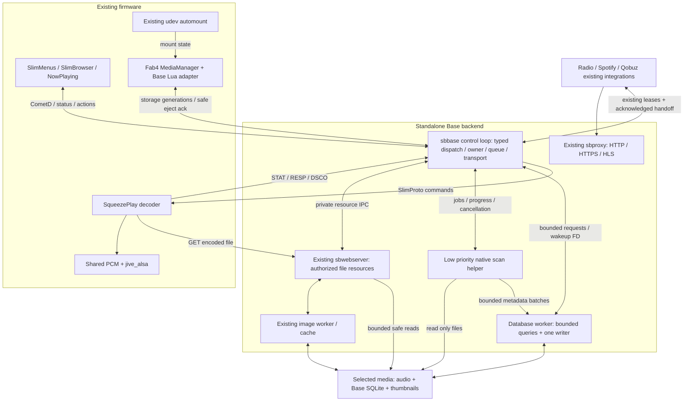
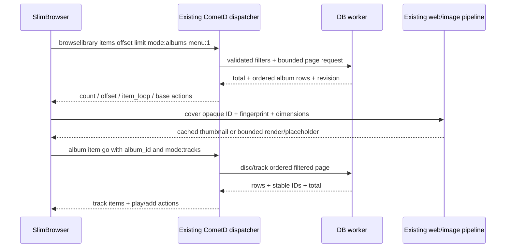

# Standalone Music Phase 0 Architecture Diagrams

Proposed design, not implemented behavior. See [report](STANDALONE_MUSIC_PHASE0_REPORT.md), [protocol](STANDALONE_MUSIC_PHASE0_PROTOCOL.md) and [evidence](STANDALONE_MUSIC_PHASE0_EVIDENCE.md). TinySC and Perl remain disabled; no arrows below involve LMS runtime.

## 1. Components and ownership



The scan-to-DB arrow is logical messaging through Base's bounded ingestion path; it does not mean shared SQLite connections or a scanner-owned writer. The existing Spotify bridge remains an app transport, omitted here for clarity; no new audio server is added. Local stream tokens resolve only to approved resources, not arbitrary files.

## 2. Scan sequence

```mermaid
sequenceDiagram
  participant A as Storage adapter
  participant C as Base control
  participant S as Scan helper
  participant D as DB worker
  participant F as Selected filesystem
  participant J as Jive
  A->>C: validated medium / generation / root
  C->>D: open schema and return existing library revision
  D-->>C: ready or explicit recovery error
  C-->>J: existing browse data available
  C->>S: incremental job with generation and budgets
  loop bounded traversal and duty-cycle slices
    S->>F: stat / bounded metadata reads
    S->>C: changed records / progress batch
    C->>D: ingest batch for current generation
    D->>D: short transaction; browse jobs have priority
  end
  alt complete root and still current generation
    S-->>C: completed traversal epoch
    C->>D: finalize unseen deletion and publish revision
    D-->>C: committed revision
    C-->>J: coalesced library/menu refresh
  else cancel / I/O failure / removal
    C->>S: cancel generation
    C->>D: abandon incomplete epoch; no deletion sweep
    C-->>J: available prior data / offline or error state
  end
```

## 3. Album browsing sequence



No browse request claims playback. If a library revision changes between pages, the response/adapter invalidates stale pages rather than silently mixing orderings.

## 4. Local playback sequence

```mermaid
sequenceDiagram
  participant J as Jive
  participant C as Base owner/queue/controller
  participant O as Existing owner adapter
  participant W as Existing webserver
  participant P as SqueezePlay
  participant A as ALSA
  J->>C: playlistcontrol cmd:load album_id
  C->>O: yield request
  O->>O: stop producer, restore hooks, reattach player
  O-->>C: acknowledged or failure
  alt yield accepted and medium online
    C->>C: commit owner generation + queue revision
    C->>W: register bounded opaque resource
    C->>P: strm-s with codec and HTTP resource
    P->>W: GET authorized encoded audio
    W-->>P: unchanged MP3/FLAC bytes with backpressure
    P-->>C: RESP / connection status / STMs
    C-->>J: confirmed current track and playing status
    P->>A: decoded PCM through existing output
    W-->>P: input transfer EOF
    P-->>C: decoder-ready / drain events
    C->>C: contextual terminal decision once per epoch
    C-->>J: new queue index or stopped/error status
  else failed yield or stale medium
    C-->>J: explicit error; local stream not started
  end
```

For MVP, wait for correct terminal conditions before next start. Later gapless prebuffer can start next input before current audible completion, requiring separate identities and metadata timing.

## 5. USB/SD lifecycle

```mermaid
stateDiagram-v2
  [*] --> Absent
  Absent --> MountPending: firmware uevent
  MountPending --> Available: existing OS mount validated
  MountPending --> Unavailable: timeout or unsupported mount
  Available --> Indexed: open existing DB or completed scan
  Indexed --> Scanning: explicit or debounced reconciliation
  Scanning --> Indexed: complete generation published
  Scanning --> Indexed: cancel retaining last valid library
  Available --> Quiescing: safe eject request
  Indexed --> Quiescing: safe eject request
  Scanning --> Quiescing: safe eject request
  Quiescing --> Unmounted: cancel scan + stop local stream + close resources + ack
  Unmounted --> Absent: firmware unmount completes
  Available --> Offline: physical removal or EIO
  Indexed --> Offline: physical removal or EIO
  Scanning --> Offline: physical removal or EIO
  Quiescing --> Offline: physical removal first
  Offline --> Absent: generations revoked; descriptors closed
  Unavailable --> Absent: removal
```



Storage arrival never starts TinySC or steals existing app playback. Safe-eject acknowledgement precedes OS unmount. Physical removal is handled even if the Lua callback is missing. Reinserted media gets a new mount generation; pending work from its earlier appearance cannot publish or reopen files. A device-path directory alone is not evidence the medium remains mounted.
