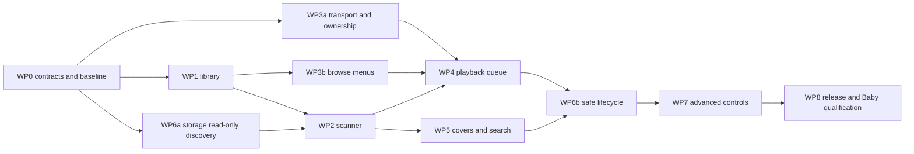

# Standalone Music Phase 0 Incremental Roadmap

Proposal only. Do not start WP0/WP1 without explicit approval. No production code or tests were implemented in Phase 0. See [report and budgets](STANDALONE_MUSIC_PHASE0_REPORT.md), [gap matrix](STANDALONE_MUSIC_PHASE0_GAPS.md), [protocol contracts](STANDALONE_MUSIC_PHASE0_PROTOCOL.md), [diagrams](STANDALONE_MUSIC_PHASE0_DIAGRAMS.md) and [evidence](STANDALONE_MUSIC_PHASE0_EVIDENCE.md).

Every package must leave Radio, Spotify, Qobuz, alarms/sleep, applet installation, artwork, time synchronization and management working. Keep feature disabled by default until its release acceptance gates pass. No firmware rebuild or TinySC activation is part of this roadmap. Device playback/media-change tests need a later explicitly authorized test session.

Storage identity/discovery and ownership are pulled forward: scanning cannot safely precede a stable root/generation contract, and local playback cannot precede acknowledged app takeover. Performance and dual-target checks start in WP0 and recur, rather than waiting for WP8.

## WP0 - Foundation contracts and evidence gates

**Goal:** turn Phase 0 choices into reviewed bounded APIs and regression fixtures without enabling local music. **Reuse:** current typed argument helper, protocol framing, Now Playing lease/status/control polling, tests, dual ARM build/package flow and existing web/image limits. **New:** exact command registry/errors, media/owner/stream generations, resource-token IPC contract, feature flag, golden source-derived Jive fixtures, baseline/performance harness design and parser comparison spike. **Expected files:** future music headers under native/sbbase/include, main/nowplaying dispatch, native/sbwebserver internal resource interface, tests, CMake and scripts/build-arm.sh; precise names are implementation choices.

**Dependencies:** Phase 0 approval, parser/license/source pin review, verified Baby memory before fixed device budgets. **Acceptance:** existing host suite passes; unchanged REST status codes/leases; malformed/batched commands cannot fall into substring play/menu handlers; all proposed fixtures parse and stock UI action parameter resolution is reproduced; cross-build minimal SQLite/parser candidates for baby/fab4 and compare stripped size, CPU/file, correctness and peak RAM. No runtime feature/port change. **Performance:** compare memory against documented targets, check control-loop slow-client waits, do not add scanning to poll callbacks. **Risks:** hidden app hook ownership and modern dependency/toolchain incompatibility. **Done:** agreed contracts, selected parser/version with measurements or explicit unresolved gate, pinned licenses, exact test matrix and disabled builds passing. This is the recommended first implementation package.

## WP1 - Portable SQLite library

**Goal:** build/open/version/query a small native library on workstation fixtures. **Reuse:** settings/alarm atomic-persistence patterns where appropriate, dual-target toolchain, existing JSON response utilities. **New:** schema/migrations, prepared query/filter API, deterministic paging, media/path identity and DB worker completion queue. **Expected files:** proposed music_library.c/.h, native/sbbase/CMakeLists.txt, build/package inputs and focused database fixtures.

**Dependencies:** WP0 SQLite build/journal policy and schema contract. **Acceptance:** insert synthetic multi-disc/compilation/multi-artist tracks; query artists/albums/genres/folders/tracks with exact counts/order at page boundaries; Unicode and duplicate titles; stable IDs on update; transaction rollback; newer-schema refusal; corrupt-copy reporting without data loss; no LMS DB access. **Performance:** 1k/10k/50k query plans, page/RAM/DB-size budgets, DB work off control loop, bounded queue/busy timeout. **Risks:** collation, ID churn, removable filesystem locking. **Done:** portable library and tests pass both target builds; disabled feature leaves existing behavior unchanged. No real-device scan yet.

## WP6a - Read-only storage identity foundation

**Goal:** validate existing mounts and represent lifecycle independently of board. **Reuse:** Platform board identity, firmware MediaManager enumeration/uevents and OS automount. **New:** portable root descriptors/media generations and Fab4 adapter; Baby unavailable adapter; no automount or scan-triggering firmware changes. **Expected files:** proposed music_storage core, applet/Platform.lua and a small new adapter, storage fixtures.

**Dependencies:** WP0 generation/resource contracts. **Acceptance:** fixture duplicate/reordered events, stale mount directories, two media, read-only mount, identity collision and reinsertion; no old SqueezeCenter start/rescan calls; no ownership claim on arrival. Later approved read-only device observation confirms active event hooks before activation. **Performance:** bounded reconciliation interval/descriptor count, no tight polling. **Risks:** stored on-mount callbacks may not execute; UUID absence/cloning. **Done:** stable testable snapshot/cancellation semantics with TinySC untouched and off.

## WP2 - Bounded scanner and metadata

**Goal:** initial/incremental library build from approved roots. **Reuse:** chosen parser primitives including existing ID3 validation, DB worker, media generations and native helper pattern from image jobs. **New:** scanner helper, traversal filters, fingerprint diff/epochs, bounded result IPC, throttling/cancellation, embedded-cover descriptors and error ledger. **Expected files:** proposed music_scan helper/music_metadata adapter, library ingestion, test corpus and native build/package entries.

**Dependencies:** WP1 + WP6a + WP0 parser decision. **Acceptance:** MP3/FLAC and supported Ogg corpus, ID3 variants/Unicode/VBR duration, malformed/oversized input, symlink loops and escapes, changed/new/deleted/renamed files, permission/EIO/cancel/removal. Only a complete root epoch sweeps deletion. Incomplete scan leaves last valid library visible. Watch overflow schedules reconciliation, no per-file notification flood. **Performance:** duty cap, peak helper/DB memory, CPU-ms/file and bytes read; browse priority between batches; no writes to internal flash. **Risks:** parser faults, blocked kernel reads, false deletion and duration estimation. **Done:** bounded/cancellable scanner with measured correctness/resource results and both-target builds; no background auto-activation until lifecycle package passes.

## WP3a - Native transport and owner handoff

**Goal:** add real single-local-player SlimProto state and acknowledged takeover before music playback. **Reuse:** frame parser, existing socket/Comet infrastructure, lease generations and app-specific Lua transports. **New:** HELO capability/model parser, STAT/RESP/DSCO interpretation, strm/gain transmitters, stream epochs and owner yield/ack interface. **Expected files:** sbbase main/protocol/nowplaying plus proposed transport controller; narrow Radio/Spotify/Qobuz adapters in their sibling repositories when approved; Base Lua ownership adapter.

**Dependencies:** WP0 contracts; synthetic transport resources permit work before scanner. **Acceptance:** byte fixtures for fragmented/coalesced frames, start/pause/resume/stop, EOF/error/unsupported codec, duplicate/stale terminal events and reconnect. A refused/unacknowledged yield cannot start audio. Exercise both takeover directions for each app, alarms and sleep in approved later tests. Qobuz reattaches SlimProto; Radio hooks stop intercepting local commands; Spotify capabilities remain honest. **Performance:** bounded socket output queues; no two-second slow-peer waits on the active control loop. **Risks:** metadata leases mistaken for physical ownership, app auto-resume and stale hooks. **Done:** deterministic tested state machine, preserved external REST contract, safe handoff demonstrated before enabling local music.

## WP3b - My Music menus and browsing

**Goal:** stock Jive Artists/Albums/Tracks/Genres/Music Folder on fixture library. **Reuse:** SlimBrowser/SlimMenus/NowPlaying, existing CometD request/event sockets and DB query API. **New:** typed BrowseLibrary handlers, menu/action serializers, menu-status merge and library revision invalidation; JSON-RPC envelope adapter to the same dispatcher. **Expected files:** sbbase dispatcher and proposed music_browse.c/.h, fixture responses, minimal Lua adaptation only if a proven contract mismatch requires it.

**Dependencies:** WP1 and WP0 golden fixtures; WP2 not needed for synthetic library. **Acceptance:** navigate all basic hierarchy levels and last/random pages, item/base action merging, disabled unsupported actions, empty/offline library, reconnect subscriptions, menu add/remove preserving alarm nodes; JSON-RPC results/errors correspond to same commands; no playback claim from browse. **Performance:** page sizes/bytes bounded, warm/cold p95, no sync SQL/tag reads in callbacks. **Risks:** returning raw query loops instead of item_loop, search/input/notification subtleties. **Done:** stock look and feel verified on Fab4 in a later approved UI session; all baseline integrations still pass.

## WP4 - Local queue and MP3/FLAC playback

**Goal:** play/add an album or track through the native queue and existing HTTP server. **Reuse:** transport/owner state, library IDs, stock decoder/ALSA, web file-serving primitive, metadata/status serializers and cover references. **New:** bounded queue transactions/revisions, opaque stream resources and trusted descriptor IPC, off-loop regular-file reads, HEAD/Range and cancellation, truthful playlist status. **Expected files:** proposed music_queue/controller code, existing sbbase dispatcher and sbwebserver http_server/resource provider, queue/HTTP/SlimProto fixtures.

**Dependencies:** WP2, WP3a/WP3b and WP6a. **Acceptance:** byte-zero MP3/FLAC on actual decoder, album order/disc boundaries, play/add/clear/next/previous, pause/resume/stop, single terminal advance, duration/elapsed, unavailable tracks, slow clients, 206/416/HEAD, >2 GiB offsets, token expiration/owner revocation, socket close with buffered audio and both-direction app handoff. Unsupported seek/gapless stays hidden. **Performance:** 60-minute playback+browse+scan with no new underruns, bounded buffers, stable FD/RAM use, control latency within budgets. **Risks:** HTTP EOF vs decoded end, descriptor removal races, firmware decoder initialization and cross-process token lifetime. **Done:** single-player MP3/FLAC MVP works with no TinySC/Perl/transcoding, all baseline integrations pass, and tests evidence budgets or document a blocking failure rather than enabling anyway.

## WP5 - Artwork completion and search

**Goal:** complete embedded/sidecar cover selection/cache invalidation and bounded searchable library. **Reuse:** existing image-render worker/cache, Jive URL normalizer/artwork queue, proxy image validators and DB query serializer. **New:** trusted local cover descriptors, per-medium validated cache root, content fingerprints/dimension variants, deterministic precedence (e.g. front-cover embedded then folder cover then placeholder), normalized search keys/input actions. **Expected files:** existing image_render/Artwork/ImageRender modules and proposed metadata/browse/library code, cover/search corpus.

**Dependencies:** WP2 + WP3b; basic original-cover references can ship before complete thumbnail/search support. **Acceptance:** JPEG/PNG embedded and folder covers, supported SVG sidecars via current renderer, oversized/malformed art fallback, cover change without seven-day stale display, two albums with same title, no file-path escape or weakened remote SSRF policy, read-only/cache-full cases, Unicode/accent and paginated search. **Performance:** hit/cold p95 and combined scan/image peak RAM; one bounded render job and existing waiter constraints, no full originals in SQL. **Risks:** 40 MiB existing child virtual cap mistaken for acceptable physical memory, missing /mnt/sbdata on Fab4. **Done:** resource targets and invalidation tests pass; existing online artwork still behaves identically.

## WP6b - Full USB/SD lifecycle and TinySC bypass

**Goal:** expose stock storage UX with Base scanning and safe removal. **Reuse:** WP6a mount state, MediaManager menus/eject ordering, OS automount, queue/controller/DB cancellation. **New:** Base scan/status menu actions replacing all TinySC activation paths, safe-eject barrier/ack, physical-removal recovery and explicit medium selection. **Expected files:** Base Lua storage adapter, platform/storage core, scanner/controller resource cleanup; touch only proven TinySC-specific integration points through a narrow adapter.

**Dependencies:** WP4 + WP5 + WP6a; power-loss tests use disposable fixtures/offline copies. **Acceptance:** startup-mounted USB/SD, insertion, duplicate/reordered notifications, mount timeout, two-media selection, read-only/unsupported filesystem, eject while browsing/scanning/playing, forced removal without callback, reinsert same/new medium and backend/UI restart. TinySC stays off and no LMS prefs/DB are changed. No writes into stale empty mount directories; no stale-generation publish or leaked handles. Recheck every firmware start/autostart path. **Performance:** bounded cancellation/UI acknowledgement and no reconnect/metadata storms. **Risks:** callback registration mismatch, firmware script races and uninterruptible I/O. **Done:** safe quiescence before unmount and responsive physical-removal behavior demonstrated on approved test media, with unchanged Radio/Spotify/Qobuz handoffs.

## WP7 - Saved playlists, repeat/shuffle, seek and resume

**Goal:** advanced controls in small subpackages. **Reuse:** queue/controller, library identity, existing status/action APIs and persistence patterns. **New:** M3U import/export (relative paths and file URLs), unresolved-member preservation, repeat 0/1/2, track/album shuffle with recoverable original order, codec-specific MP3/FLAC seek maps and restart headers, coarse queue/position checkpointing. **Expected files:** queue/library/metadata/transport/browse modules, new focused playlist/seek fixtures; no second protocol backend.

**Dependencies:** stable WP4/WP6b; each advanced option stays disabled until its own tests pass. **Acceptance:** playlist order/Unicode/missing files, rename/remount identity, deterministic repeat/shuffle including queue edits, VBR MP3 and FLAC exact/approximate seek tolerance stated, seeking near EOF and after pause, restart with missing media, no autoplay after reboot, bounded checkpoints. Gapless is a separate optional gate with codec-pair and audible-boundary tests, not bundled into basic next/previous. **Performance:** seek latency and sparse-map size, DB writes and long-queue memory; no per-second flash writes. **Risks:** malformed M3U escapes, ambiguous identity, seek corrupting decoder state and wrong audible metadata timing. **Done:** each advertised capability is validated end-to-end; incomplete ones remain hidden with explicit unsupported results.

## WP8 - Release performance and Baby qualification

**Goal:** qualify cumulative architecture and portable core before enabled release. **Reuse:** dual-platform toolchains/packages, test/profiling harness, Base management monitor and all existing applications. **New:** final tune limits/duty cycles, verify Baby hardware and future-storage adapter contract, release evidence and regression matrix. **Expected files:** measured limit configuration/build inputs, tests and research/release docs; Baby hardware USB enablement is a separate hardware task.

**Dependencies:** prior MVP packages; WP7 only for advertised advanced capabilities. Baby must fail cleanly with storage unavailable on ordinary hardware. **Acceptance:** 1k/10k/50k scaling, idle/cold/incremental, scan+browse+art+play, prolonged reconnect and FD/memory stability, old Linux syscall behavior, Baby ARMv5 and Fab4 ARMv6 static builds, package target checks, all existing Radio/Spotify/Qobuz/alarm/installer/time/storage-management regressions. Record unsupported cases instead of extrapolating Fab4 success. **Performance:** report every budget and baseline delta, including combined workers and shared-memory caveats; remove unbounded waits/memory growth found earlier. **Risks:** peak memory contention, USB filesystem stalls, assuming C alone is fast, missing Baby memory/storage evidence. **Done:** measured acceptance report, license/source/notice inventory, independently reviewable enabled feature/release proposal; publishing/deployment requires its own user instruction.

## Common definition of done and stop boundary

For each package: source changes narrowly scoped and reviewable, meaningful unit/fixture tests plus relevant integration checks, both target builds, feature-disabled regression checks, measured resource impact and truthful capability flags. Protocol handlers share dispatch/query logic; no extra HTTP server, native decoder, ALSA layer, artwork cache service or LMS runtime. Any missing evidence is a follow-up gate, never a silent assumption.

This document is an implementation plan only. Phase 0 ends here; none of these packages has been started.
