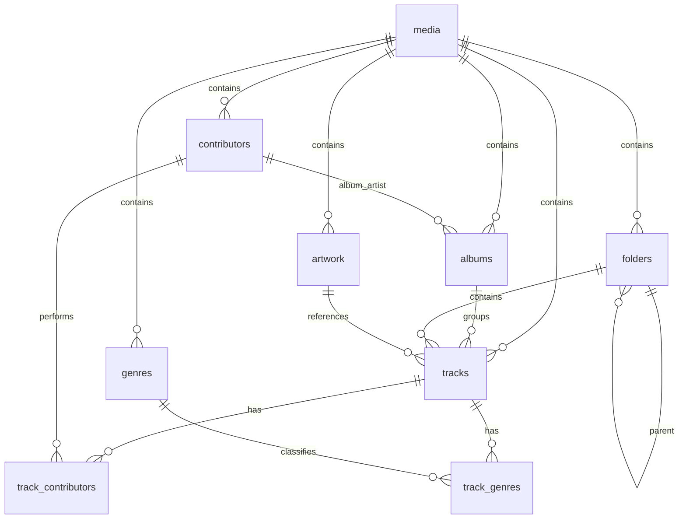

# Standalone Music WP1 Schema and API

Completed 2026-11-02. Implemented in [music_library.h](../native/sbmusic/music_library.h), [music_library.c](../native/sbmusic/music_library.c) and [schema.h](../native/sbmusic/schema.h). SQLite 3.54.1 is vendored from the verified official amalgamation; [provenance](../native/sbmusic/third_party/sqlite/PROVENANCE.json) records hashes/license. No LMS schema/runtime is used.

## Schema version 2

Application ID `1396854101` identifies Standalone Music. `PRAGMA user_version=2` is the schema version, separate from `library_meta.revision`. Empty creation requires explicit create permission; foreign nonempty databases are refused. Newer versions are refused before schema migration or journal-policy changes. Version 1 is this native schema without fingerprint/scan_epoch; a transaction adds both fields with defaults and updates user_version. Read-only v1 returns migration_required. SQLite normal hot-journal recovery is supported; no custom destructive recovery or file replacement exists.

| Entity | Identity and relationships |
|---|---|
| media | integer ID plus unique 16-byte stable source ID; last observed generation/availability |
| tracks | AUTOINCREMENT ID; unique media/normalized relative path; album/folder/artwork FKs; disc/track/year, duration, size/mtime, codec/rate/channels/bitrate, audio offset/length, fingerprint and future scan epoch |
| albums | stable ID, unique media/album key, title, distinct album artist, compilation/year |
| contributors | stable ID, unique media/exact name; shared performer/album-artist identities |
| track_contributors | many-to-many, role 1 performer / 2 album artist, ordinal; composite primary key WITHOUT ROWID |
| genres / track_genres | normalized entity plus many-to-many membership; WITHOUT ROWID link table |
| folders | unique media/relative path, parent ID and basename; empty-path root |
| artwork | stable opaque reference ID, unique media/reference; no image blobs, extraction or resizing |
| library_meta | singleton monotonic revision; native schema version remains in user_version |

Committed IDs survive metadata updates, rename by explicit track ID, close/reopen and source reinsertion. Delete removes the track and cascades links; committed track IDs are never reused. IDs returned inside an uncommitted transaction are provisional until commit. Unreferenced albums/contributors/genres/folders/artwork remain as identity records; browse queries exclude unused music entities, while empty known folders can remain visible. No automatic garbage collection or mass deletion is implemented.

Explicit album keys group multiple discs and distinguish same-title releases. Without a key, a length-delimited tuple of directory/title/album artist is used; grouping across disc directories therefore needs an explicit key from the future metadata layer. Missing title uses the filename; missing album uses an Unknown album label. Compilation and album-artist values are supplied metadata, not guessed. Multiple artists/genres are bounded to eight each. Contributor identities are case-sensitive exact UTF-8 strings; aliases, NFC normalization and artist-name splitting are not inferred.

Indexes serve actual paths: media/path uniqueness, track media/title/ID, album disc/track/ID, direct folder/name/ID, recent mtime/ID, album name/ID, contributor-to-track and genre-to-track reverses, folder parent/name/ID. No speculative scan-epoch or full-text index was added. Artist ordering uses a small temporary sort; EXPLAIN plans and index byte sizes are measured.

## WP0 contracts and native API

WP0 `sb_music_source_id`, `sb_music_media`, `sb_music_track_id`, `sb_music_query`, `sb_music_page` and `sb_music_row` remain the data model. Small internal extensions add a search-field selector, row kind for mixed folder pages, and a context pointer on the previously API-only query provider. There was no existing provider implementation or runtime C ABI consumer to migrate. `sb_music_library_queries()` now implements that provider for an individual worker; no singleton/global query dispatcher is introduced.

Factory `sb_music_library_start(options)` validates and copies an explicit absolute database filename and starts one dedicated worker. Open itself runs there and completes as request 0. No constructor is called by sbbase. `submit()` and `receive()` use a single-flight copied mailbox and try-locks: busy means retry later, not wait for SQL. `fd()` supplies a nonblocking notification pipe for a future existing control loop. Caller must not drain the pipe independently. There is no second event loop. `destroy()` refuses until a completed CLOSE or failed OPEN is received; joining then cannot wait for a live SQL operation. One 256 KiB worker stack and bounded request/result structures are allocated per explicit handle.

Operations: SOURCE, BEGIN/COMMIT/ROLLBACK, UPSERT, DELETE_TRACK, QUERY, DETAIL, STATS, PLAN and CLOSE. Every SQL statement is prepared; all application values are bound. SQL construction chooses only fixed internal entity/filter/sort fragments. No raw-SQL operation is public. Import uses explicit transactions with an owner token; mismatched tokens cannot read uncommitted state. SQL write failures roll back; structural validation errors leave the caller-owned transaction available for explicit rollback. Removal rolls back pending metadata changes even without its transaction token. Cancelling a VM operation rolls back a pending transaction; cancellation is cooperative and request-ID checked.

Request IDs increase monotonically per handle; stale IDs/cancel callbacks are refused. UINT64_MAX is reserved for final CLOSE. Each successful logical data transaction publishes one revision. Writes advance persisted revision atomically; another handle's changes are detected by a revision refresh. Query counts and page rows share a read snapshot. Runtime availability changes also advance the handle revision, including read-only handles; cache keys are scoped to handle/incarnation plus media generation, not persisted revision alone.

## Query behavior and bounds

Artists, albums, tracks, genres, artist albums, album tracks, genre artists/albums, direct folder contents and individual track details are implemented. Folder pages contain typed folder/track rows. Saved playlists remain unsupported. Optional artist/album/genre/folder IDs filter tracks and related entities. Search has ANY/TITLE/ARTIST/ALBUM selectors. ANY searches the entity label for artist/album/genre pages and title/album/contributors for track pages. Folder pages allow only name filtering, not ambiguous artist/genre subtree filters.

Pagination has explicit offset/limit, total count, returned count, library revision, media generation and byte count. Maximum 50 rows / 16384 DTO bytes; no entire result list is loaded by C. Ordering is deterministic with ID/type tie-breakers. Tracks also support disc/track order and recent order; those sorts are unsupported for other entities. A supplied stale library revision is refused. An unavailable/unregistered source returns offline; wrong generation returns stale. A structurally invalid WP0 query (including an online=false request snapshot) returns invalid before SQL. Missing tracks return not_found; absent filters/last-page offsets produce zero-result pages.

Search strings are literal prefixes; percent/underscore/backslash are escaped rather than interpreted as user wildcards. All filtering is parameterized. SQLite LIKE/NOCASE folds ASCII only; non-ASCII case/accent folding is not promised. UTF-8 values are validated and stored without encoding loss; display labels truncate at a code-point boundary to the WP0 128-byte fields. Full bounded track/album/contributor metadata is returned by DETAIL. Limits include 4095-byte relative paths, 511-byte titles/albums, 255-byte contributor names and 127-byte genre names. Invalid UTF-8/control characters, absolute paths, dot/dot-dot segments, backslashes and empty path segments are rejected; WP2 must supply canonical relative paths. Arbitrary raw-byte filenames need a future explicit policy, not silent lossy conversion.

File sizes, offsets, IDs, durations and epochs use native 64-bit types, accepting nonnegative values through INT64_MAX for SQLite INTEGER. Offsets/lengths are overflow-checked; >4 GiB fields are tested. No music file is opened.

## Persistence, journaling and errors

No default database filename/root exists; create is false unless explicitly requested. No mkdir, internal-flash fallback, automounter or mount inference exists. The future storage adapter must validate the root before supplying the filename and must not grant create on a stale mount directory. Up to sixteen runtime source slots are supported. Persisted availability is historical only: each new handle starts with no trusted online sources until SOURCE registration. Generation allocation/real media identity belongs to WP6a.

DELETE journaling is default; WAL requires explicit wal_safe policy. Returned journal mode is checked. FULL synchronization is used for writes, with a 64-page WAL autocheckpoint, foreign keys, trusted_schema off, mmap off and a 512 KiB page cache configured before integrity checking. Temp storage is memory. This is not proof of FAT/NTFS/USB power-loss durability. Read-only DELETE databases require no database writes; read-only WAL also depends on readable/existing sidecars and filesystem permissions. Unsupported journal/locking behavior is reported; no fallback silently forces WAL or internal storage.

An 8 MiB hard limit is applied once to the shared vendored SQLite allocator without raising an existing stricter limit; worker/request/stack memory is additional. Limit errors are explicit. VM progress/deadline cancellation and <=200 ms configured lock busy time keep database work bounded where SQLite can cooperate; kernel I/O stalls cannot be forcibly cancelled. The control thread never performs SQL or joins an active worker. All errors complete through the mailbox.

I/O errors invalidate runtime sources and require explicit close/reopen of validated storage. Offline transitions do not write availability back to a removed filesystem. Corruption/newer/foreign schemas are preserved and reported; recovery is operator-controlled. No automatic deletion/rebuild exists. Safe close rolls back uncommitted work and lets SQLite manage its journal/sidecars normally.
