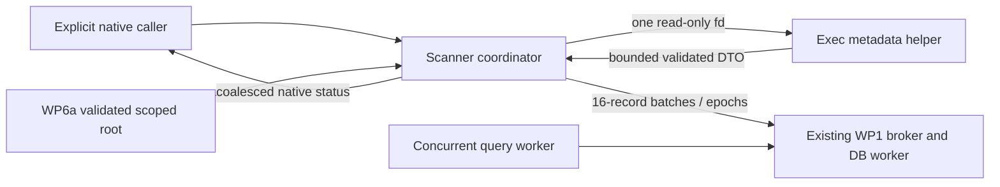

# WP2 scanner design and native contracts

2026-11-02. [Implementation](../native/sbmusic/music_scanner.c), [API](../native/sbmusic/music_scanner.h), [metadata reader](../native/sbmusic/music_metadata.c), [helper](../native/sbmusic/music_metadata_helper.c), [WP1 scan operations](../native/sbmusic/music_library_scan.inc). No runtime entry point in sbbase, public endpoint, insertion listener, menu, playback or unmount action constructs the scanner. `SB_MUSIC_ENABLED` remains 0 and the existing CMake product activation gate remains OFF/rejects ON.

## Ownership and scheduling

One explicitly constructed coordinator thread owns traversal, up to sixteen pending records and one parser child. The caller supplies an already validated WP6a root descriptor, current WP0 source/generation, trusted helper executable and an already opened/registered, independently approved WP1 database. Missing approval is POLICY, disabled construction allocates nothing, and no filename-to-database or internal-flash fallback exists. File operations never run on the Base protocol loop.

A thread alone is cheaper but cannot contain a native parser crash or terminate a wedged parser safely. A complete separate scanner process would require another database connection or a substantial new database IPC broker. The selected coordinator thread plus **exec-isolated per-file metadata helper** reuses the existing WP1 worker, POSIX worker/pipe patterns and existing image helper's process-limit approach. There is no second SQL connection, event server or scheduler daemon. `posix_spawn` avoids running application parsing/allocator logic between fork and exec in a multithreaded process. Helpers receive a read-only fd, never an arbitrary pathname; inherited unrelated descriptors are closed in the single-threaded helper.

The worker sleeps on its condition variable while idle. Native request/cancel/media/status/stop/destroy APIs use try-locks and no filesystem/SQL work. One request can be active; repeated requests return BUSY, stale request IDs are rejected. Status is a copied bounded snapshot: IDLE, QUEUED, SCANNING, COMMITTING, COMPLETED, CANCELLED, FAILED or MEDIA_REMOVED. Counters include visited/recognized/new/updated/unchanged/renamed/removed/errors, elapsed time, media generation, scan epoch, library revision, metadata bytes and parser peak RSS. No exact percentage is invented. Notifications are coalesced at 250 ms plus state boundaries; no per-file CometD events exist. Status drains its wakeup pipe under the snapshot lock to avoid losing a terminal notification.

Coordinator stop is asynchronous. Destruction refuses until the worker has exited, then joins an exited thread and closes owned descriptors. Cancellation wakes helper polls, requests cancellation only of a matching scan-token database job, kills/reaps the helper and aborts an unfinished ingestion transaction. A media/source/generation mismatch latches revocation for that scanner handle: replaying an old online snapshot cannot restore it. Reinsertion needs a newly validated root and scanner handle. Ordinary cancellation can be followed by another request on the same still-valid root.

Cancellation becomes BUSY once COMMITTING is published: the final successful-root transaction has a defined commit admission point and cannot be represented as an already acknowledged cancelled scan. Generation revocation still invalidates admission and matching pending SQL. SQLite cancellation is cooperative and checked before finish commit. Already committed, fully validated additions/updates are retained; a completed root snapshot is not retrospectively reinterpreted as an empty unavailable root. Kernel uninterruptible I/O can delay actual child exit/worker destruction despite SIGKILL; no claim of forced cancellation of a D-state kernel operation is made. The control loop never waits for that worker.

## Traversal and storage reuse

WP6a adds `sb_storage_root_child`: a descriptor-anchored validated scope within the actual mount. It records a canonical relative scope and checks both mount identity and scoped inode/path on revalidation. It never authorizes an ordinary directory as a mount. This permits controlled tests under a private directory of the real `/dev/shm` mount and later explicitly selected subtrees. Open-relative checks include that scope when refusing nested mounts. Every scan opens a fresh directory description with openat(root,"."); dup alone would share a directory offset and could make the next scan falsely appear empty.

Traversal uses a fixed iterative DIR stack, fstatat with AT_SYMLINK_NOFOLLOW and the existing WP6a secure open-relative API. It does not follow symlinks. Device/inode ancestor checks refuse directory loops; mount validation refuses nested/bind escapes. Regular files with mp3/flac/ogg extensions are candidates, but the parser determines format from signatures. Other extensions, special files and symlinks are ignored. Hidden Base/LMS/cache/metadata directories including `.StandaloneBase`, `.Squeezebox`, recycle/trash/indexing directories and lost+found are skipped; no cache directory is created. Permission masks denying reading/traversal and actual operation failures are recorded as incomplete, even on a privileged test host.

Directory mtime/ctime is compared at completion, and each file's size/mtime/ctime is checked around fingerprint/probe work. A changed/inaccessible subtree/file, invalid encoding/path bound, parser error/limit, incomplete readdir, mount loss or cancellation suppresses the missing-track sweep. This is not an atomic filesystem snapshot: change-and-restore between observations or hostile mount-namespace races cannot be fully excluded by old-kernel APIs. No advisory lock is assumed to freeze external media writers.

| Bound | Implemented policy |
|---|---|
| Relative/root scope | WP6a 1023 bytes, including combined scope; explicit error, no truncation |
| Directory stack | 16 levels, iterative; overflow makes scan incomplete |
| Entries | 1,000,000 per request |
| Pending tracks | At most 16 copied WP1 records; no unbounded filename/result list |
| Error ledger | 16 entries with bounded path/message; total counter retained, stop after 64 errors |
| Parser children | One, always owned/reaped before another starts |
| Descriptors | Fixed stack plus a bounded handful of root/pipe/spawn descriptors; conservative scanner-owned allowance depth+12, at most 28, excluding caller/DB/stdio |
| Metadata block/packet | 256 KiB; actual media reads at most 768 KiB per probe |
| Parser budgets | 16 MiB virtual address space, 512 KiB stack, 2 s CPU, no core files, 64 FD ceiling; configurable wall timeout <=5 s |
| Worker stack | 512 KiB coordinator; existing WP1 worker remains 256 KiB |

These are bounds, not measured Baby RAM or CPU percentages. The helper only reads metadata/header/tail spans, never a whole large audio file or artwork decoder. It closes unrelated inherited fds, applies process limits and lowers its priority best-effort. Original kernel capture is Linux 2.6.26; these POSIX/2.6-era primitives avoid pidfd/openat2/statx/prlimit/cgroups. Cross-build/QEMU exercise the code on the host kernel; exact old-kernel availability, policy limits and faulty-media behavior still need approved device qualification. nice/setpriority is not a CPU quota, and RLIMIT_AS is virtual memory, not an RSS cap.

Configurable `work_duty_percent` schedules a work/rest wall-time ratio (default 50), `yield_ms` imposes per-file cooperative pauses and `io_bytes_per_second` optionally paces bounded payload reads with a one-file burst. Sleeps are interruptible through the wake pipe. Directory/proc metadata and kernel/device scheduling are outside that payload model; neither a precise CPU share nor exact whole-device I/O rate is promised. Benchmarks explicitly use 100/unpaced to measure throughput. No real app playback-pressure scheduling is activated in WP2.

## WP1 schema, ingestion and visibility

Owned schema version **3** adds bit_depth/track_total/disc_total/full release_date/total_samples, a scan counter, persisted per-source root scope and a media/fingerprint index. Existing v1->v2 and v2->v3 steps are transactional; read-only old schemas require migration and preserve their bytes. IDs and existing metadata survive. All new SQL is prepared/bound on the same WP1 worker. There is no LMS database access.

SCAN_START binds a source to its fixed scope and allocates a monotonic persisted epoch. A different scope, or adopting a nonempty old catalogue with no recorded scope, is refused rather than treating its tracks as missing. An explicit future root-adoption policy is required for such old catalogues. A newer scan epoch on another handle supersedes old work; scanner operations check the persisted epoch before modifying/finalizing. Normal product policy still permits only one scanner per supplied library. External writers must honor this scan ownership contract.

SCAN_LOOKUP fetches a full bounded DTO by source/path or a unique source/fingerprint candidate. Unchanged files queue lightweight SCAN_TOUCH epoch updates; new/changed files queue UPSERT. At most sixteen records are committed per transaction. Queueing does not count as a committed addition/update. Errors/cancellation roll back the current batch while earlier completed batches remain useful. Initial scans force parsing; incremental scans compare bounded fingerprints and skip parsing for unchanged files.

Fingerprint v1 includes filesystem device/inode, size, mtime with nanoseconds, a bounded first/last 256-byte digest and selected sidecar revision. It is not a cryptographic full-content hash. Same size/timestamp/edge bytes can conceal changes; FAT timestamp precision and unstable inode behavior remain limitations. Path identity preserves IDs on ordinary updates. Inode-based rename/hardlink matching is explicit opt-in only for ext2/ext3 or controlled tmpfs; VFAT/NTFS are refused for that option. A unique old candidate, matching fingerprint, single link and a securely confirmed absent old path are required for rename. Ambiguous cases remain separate/new identities; identical titles/tags never merge tracks. Pending and already stamped inode aliases are coalesced where determinable. Cross-directory artwork changes may deliberately defeat rename confidence.

SCAN_FINISH is admitted only after a complete successful traversal, committed ingestion batches and current root/generation validation. It checks the current persisted epoch/media, deletes only different-epoch tracks for that source and commits atomically, with cooperative cancellation before commit. Otherwise SCAN_ABORT clears scan ownership without a deletion sweep. No absent medium is ever interpreted as an empty successful root. A safely completed genuinely empty selected root can remove its old records; a missing/stale/unreadable directory cannot.

Worker clients use `sb_music_library_exchange`, a serialized blocking broker over the **same** WP1 mailbox/connection, with allocated request IDs and existing FD waits. All consumers of that handle must use this broker while scanning; mixing raw submit/receive could steal completions and is forbidden. It is a worker-only API, never a protocol callback. Concurrent query workers can run between scanner jobs/batches; transaction-owner conflicts are explicit and retried by the test query client. A future asynchronous browse dispatcher must multiplex this ownership properly rather than call exchange on its control loop. This is an explicit future integration boundary, not a new live browse endpoint.

## Persistence and stop boundary

Read-only audio media is usable with an explicitly approved separate writable library. A read-only library refuses ingestion. WP1 DELETE/FULL and explicit WAL policy remain; no filesystem name alone authorizes WAL. No removable database is opened automatically, and no descriptor-safe VFS/real-media persistence qualification is claimed. New on-medium writes remain blocked by the WP6a placement gate. No internal flash fallback, markers, hidden caches, automatic insertion scan, safe eject, Jive browsing or audio playback is added.

