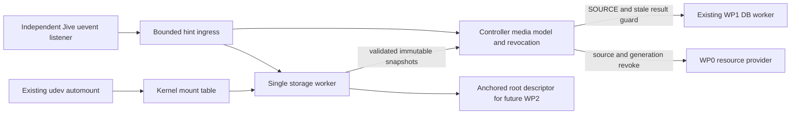

# WP6a native storage contract

2026-11-02. Implemented source: [portable model](../native/sbmusic/music_storage.c), [public API](../native/sbmusic/music_storage.h), [Linux validation/worker](../native/sbmusic/music_storage_linux.c), [Fab4 controller adapter](../native/sbmusic/music_storage_adapter.c), [WP1 bridge](../native/sbmusic/music_storage_library.c). These are isolated static libraries; normal Base never constructs them. No new server, scanner, automounter, playback controller or filesystem writer exists.

## Identity and bounds

The model reuses WP0 `sb_music_source_id` and `sb_music_media`; it does not invent a parallel generation type. Sixteen medium slots and sixteen reliable identity records are supported. Slots are controller-owned, never shared mutable worker state. Overflow returns an error rather than evicting a live identity. Each medium records source, generation, device, canonical mountpoint, mount ID, filesystem/root, filesystem major/minor, source type, mounted/online/writable flags, state/error, last successful validation time and opaque library association. Mount read-only state remains visible independently of online capability; writable means a validated rw mount, not proof that every pathname is writable or that SQLite durability is qualified.

Persistent evidence requires **both filesystem UUID and hardware/partition identity**. Linux obtains these from the firmware's `/dev/disk/by-uuid` and `by-id` entries after matching their target block device. A directory walk is bounded to 512 entries; multiple matching aliases, missing identifiers or unavailable directories result in uncertainty. Labels, `/dev/sda1`, enumeration order and mountpoint names never establish persistent identity. The serial/partition key keeps two partitions of one device distinct. UUIDs with different serials remain separate. An exact composite identity concurrently in use quarantines the previous source, taints its registry record and assigns a separate session identity. Later tainted appearances remain session-scoped. This cannot distinguish malicious or indistinguishable cloned UUID+hardware identifiers appearing at different times; such evidence needs an explicit user/device policy before automatic association can be trusted.

IDs are a caller-supplied nonzero random 64-bit incarnation plus a monotonic 64-bit identity counter, with registry/current-source collision checks. They are identifiers, not authorization secrets. Reliable IDs are recovered by lookup/import, never by a lossy hash. Registry import/export and library association are explicit in-memory APIs; WP6a does not persist settings, write markers, create directories or open a DB to obtain them. A future enabled controller must persist reliable records on an independently approved store. Without that, persistent recognition is limited to the lifetime of the registry, and restart deliberately loses automatic association. Import rejects duplicate IDs/evidence. Library association follows reliable identity through reinsertion; uncertain media do not inherit an old association.

Generations are nonzero, globally monotonic within this controller incarnation, bounded by INT64_MAX for WP1. Removal changes `online` to false immediately; offline SOURCE updates use the revoked generation. Every new availability interval gets a new generation even when the source ID is retained. A controller restart must close all previous root/resource handles and discard callbacks/IPC connections before importing identities. Generations and event sequences are not transferable between controller incarnations.

## Deterministic transitions

| Input | Required current context | Result |
|---|---|---|
| INSERT | new slot or new mount interval | Assign/recover source, allocate generation, MOUNT_PENDING, online=false; mounted reflects observed mount ID |
| identical INSERT | AVAILABLE or MOUNT_PENDING, same mount/evidence | Coalesce; preserve generation and availability |
| VALIDATED | matching generation and mount, pending/available | AVAILABLE, online=true, writable=!ro, update validation time |
| delayed VALIDATED | pending mount ID=0, same device/path | Fill actual mount record and become AVAILABLE without another generation |
| REMOVE | matching generation | OFFLINE, online=false, mounted=false, writable=false |
| EJECT_REQUEST | matching available generation | QUIESCING, online=false, writable=false; retain observed mount |
| UNMOUNT_OBSERVED | matching generation | UNMOUNTED, online=false, mounted=false |
| FAILURE | matching generation | UNAVAILABLE, online=false, writable=false, explicit error; preserve last observed mount/validation |
| stale/duplicate sequence, wrong generation | any | Refuse; never reactivate stale work |

ABSENT/DISCOVERED/ERROR names remain available in the contract; the native adapter combines initial discovery with MOUNT_PENDING, and uses ERROR for identity quarantine. Read-only storage is AVAILABLE for reads. Unsupported filesystems remain observed but UNAVAILABLE. Filesystem I/O failures revoke admissions. Reinsertion or a changed mount record starts another generation. Mountpoint reuse does not transfer source/track identity.

`sb_storage_change` describes previous/current snapshots and revocation. A collision can also revoke another slot: consumers must compare **all** previous online snapshots against the new model after every event. `sb_storage_revoke_resources()` calls the existing WP0 resource provider's `revoke_media(source,generation)`. These are admission/cancellation notifications, not a promise that an in-flight kernel read has stopped. Every worker result/read must still pass `sb_storage_current()` against the live controller snapshot.

## Authoritative roots and anchored access

`/proc/self/mountinfo` is the root authorization source: mount ID, filesystem major/minor, mount root, mountpoint, device, filesystem and both mount/superblock read-only flags are checked. A bounded `/proc/mounts` parser is retained for discovery if mountinfo is absent; **mounts-only observations cannot authorize file access**. This avoids guessing a mount incarnation from a device node or directory. IDs can be reused by Linux after unmount; hints, invalidation and bounded reconciliation are still necessary. The exact old target's mountinfo availability has not been observed; the recorded kernel version supports its introduction, but runtime absence fails closed.

Input limits: 1 MiB table, 128 mount records, 8191-byte lines, 80 fields, 1023-byte root/path, 255-byte device, 31-byte filesystem. Kernel escapes for space/tab/newline/backslash are decoded; incomplete/unknown escapes, truncation and limits fail closed. Literal spaces in unrelated driver super-options are tolerated after the fixed identity fields (observed on WSL 9p). A malformed/oversized table is an error, not an empty-medium report.

Validation requires an exact mount record under an explicit approved parent, canonical absolute path, mount root `/`, one unambiguous matching mountpoint, allowed filesystem, and fstat filesystem major/minor agreement. For real removable roots, the source must remain a block device; non-FUSE rdev must match mountinfo. FUSE mount device numbers describe FUSE rather than the underlying NTFS block device, so that equality is deliberately not asserted. Both must still exist. Bind subroots, unexpected paths and symlinks in any absolute component are refused. A stale empty directory has no matching mount record and is refused before opening. Default Fab4 discovery exposes only `/dev/...` sources under `/media`; generic validation also supports an explicitly approved tmpfs root for volatile use and real host tests, without advertising it as USB/SD.

The owned root handle contains one fd, WP0 media snapshot, immutable mount record and root dev/inode. `openat` walks one component at a time using O_NOFOLLOW/O_DIRECTORY and O_NONBLOCK, applies FD_CLOEXEC, checks same filesystem and rejects special files. Relative input rejects absolute/dot/dot-dot/empty segments, backslashes and control bytes. Nested mounts, including same-device binds, are rejected by mount-table checks before/after open. Root path/inode and mount identity are checked again after opening. Files are not streamed or scanned. Caller closes each successful returned fd and root handle on every exit path; descriptor pinning does not authorize access after revocation.

Linux 2.6-era APIs are used: openat/fstat/dup/fcntl/read/poll/pthreads, not openat2, statx, O_PATH, pidfds or modern mount APIs. Independent checks minimize races but cannot atomically exclude hostile concurrent mount-namespace changes with these APIs. Kernel I/O can block despite O_NONBLOCK on regular files. All root validation/access runs on a worker; consumers must recheck generation on completion and later reads. Host/QEMU success does not qualify old-kernel removal races.

## Asynchronous adapter and WP1

The Fab4 adapter owns one storage worker with a 256 KiB stack and single-flight mailbox. Submit/receive/stop/destroy use try-locks; the worker performs mount reads, root validation and identity resolution. Results include per-mount validation/error/evidence and are copied through a nonblocking CLOEXEC pipe. Request IDs are monotonic. The caller owns the existing scheduler: pump on wakeup or returned deadline. Startup discovers once; insertion permits 1-second delayed-mount retries for at most 60 seconds; available media receives a 30-second reconciliation backstop; no-media idle has no deadline. Notifications coalesce to a dirty bit, not an unbounded queue. Removal of a disk also revokes its partitions. A remove hint synchronously revokes matching model snapshots even while discovery is blocked. Any hint during discovery discards that result. Removal tombstones prevent the same stale mount record from reactivating without a new add or changed mount identity. Stale ingress sequences cannot clear a tombstone.

Eject is a **request** only. The adapter validates source/generation, enters QUIESCING and blocks reauthorization of that mount. It neither unmounts nor reports safe completion. An independently observed absent mount can become UNMOUNTED. Async stop revokes model availability; destroy refuses until the worker has exited. Nothing waits on a live filesystem operation in a protocol callback. A stalled kernel syscall can still delay worker exit; WP6b must handle that explicitly.

The WP1 bridge publishes explicit SOURCE snapshots to an **already independently validated/opened** database. Offline publish requests cooperative cancellation of a known pending request, returns BUSY rather than waiting, and must be retried after its completion is drained. Latest offline snapshots take precedence in the caller's scheduling; never drop them on BUSY. Result guards reject a formerly valid page/detail immediately after model removal, before the DB worker acknowledges SOURCE. Offline SOURCE rolls back transactions without deleting committed tracks; reliable reinsertion registers the same source and a new generation, preserving track IDs. No background SQL starts on storage arrival or while disabled.

WP6a deliberately provides no pathname-to-removable-DB open/create helper. WP1 opens filenames, including journal sidecars; a validated root plus string concatenation cannot prevent a concurrent unmount from redirecting creation into the underlying empty directory. A future descriptor-anchored SQLite VFS or equivalent lifecycle barrier and filesystem qualification are prerequisites. Until then this adapter does not grant removable DB writes or silently fall back to internal flash. Read-only recovery/WAL sidecar requirements also remain explicit. WP2 may use secure root handles for bounded reads and a separately approved fixture/volatile library, but must not infer permission to create an on-medium database.

Baby/disabled constructors return NULL before allocation, pipes or threads; the pure model returns DISABLED. There are no menus, timers, hardware claims or Fab4 Lua dependencies on Baby.
